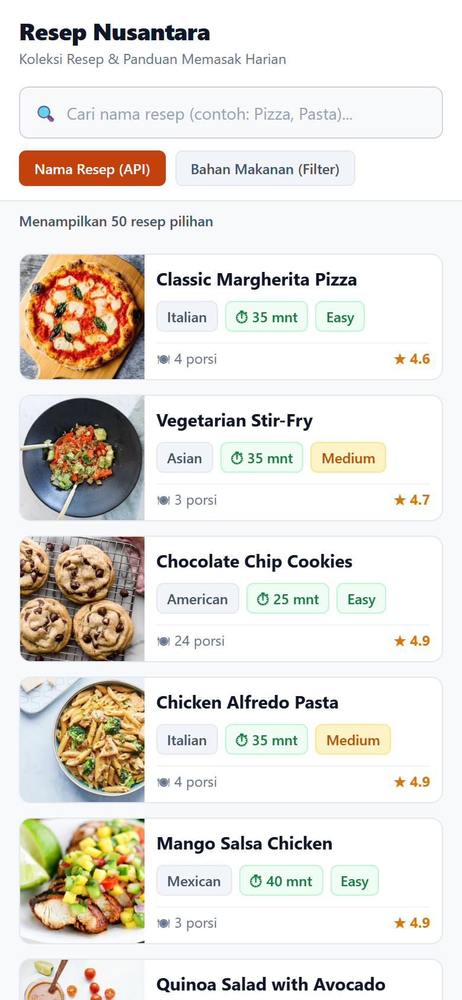
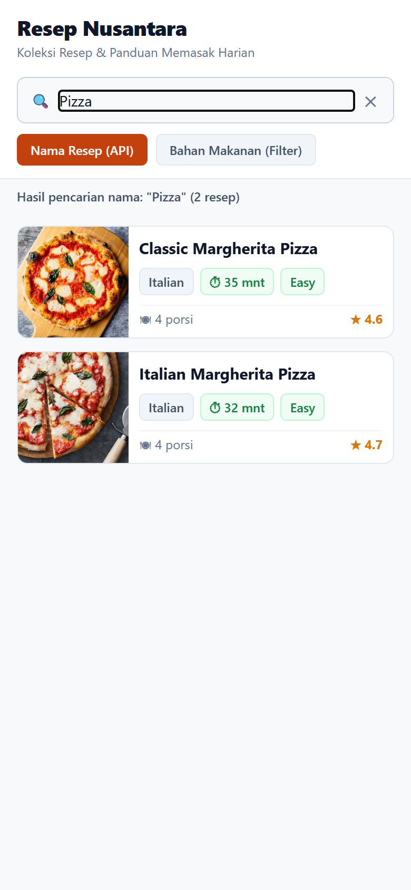
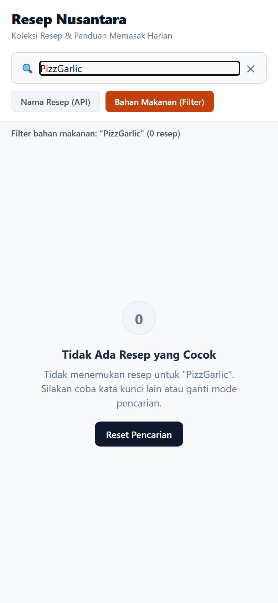
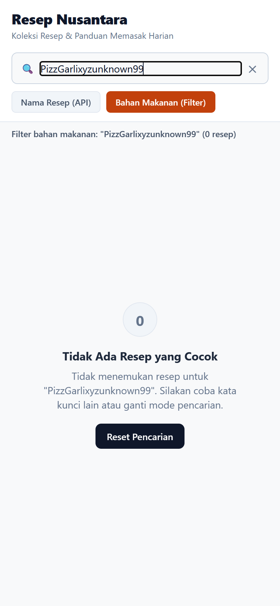
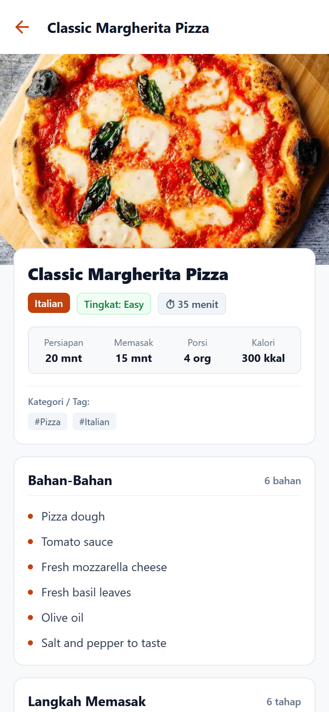
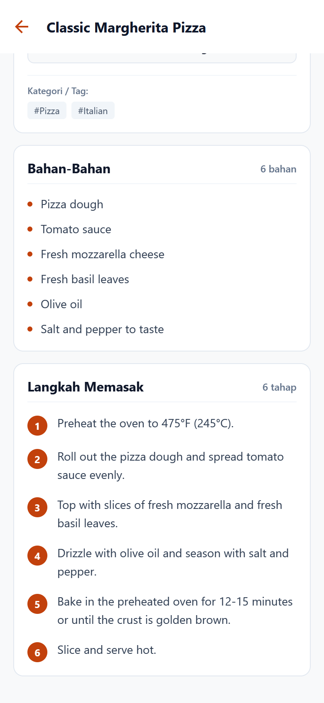

# Resep Masakan Mobile App (UTS Pemrograman Mobile Lanjut - Soal 2)

**Identitas Mahasiswa:**
- **Nama:** Wisnu Widya Pradana
- **NIM:** 411231088
- **Mata Kuliah:** Pemrograman Mobile Lanjut (412573401)
- **Topik:** Aplikasi Resep Masakan (Inspirasi Cookpad)

---

Aplikasi mobile pencarian dan panduan resep masakan berbasis **React Native (Expo)**, **TypeScript**, dan **TanStack Query**. Mengambil data langsung dari DummyJSON Recipes REST API dengan optimasi server-state management (caching, skeleton loading, error handling retry, debounce search).

---

## Preview & Tangkapan Layar Aplikasi

Berikut hasil uji tampilan dan fitur aplikasi di layar mobile:

| 1. Katalog Resep Utama | 2. Pencarian Nama Resep | 3. Pencarian Bahan Makanan |
| :---: | :---: | :---: |
|  |  |  |
| *Daftar resep dari API* | *Debounce search (API)* | *Filter bahan resep* |

| 4. Empty State | 5. Detail Resep (Informasi & Bahan) | 6. Detail Resep (Langkah Memasak) |
| :---: | :---: | :---: |
|  |  |  |
| *Tampilan data tidak ditemukan* | *Foto, kalori & bahan* | *Instruksi bernomor urut* |

---

## 1. Fitur Utama

1. **Katalog Resep (REST API Real-time):**
   - Mengambil data asli dari endpoint `https://dummyjson.com/recipes`.
   - Menampilkan thumbnail, nama masakan, cuisine, waktu masak, porsi, rating, dan tingkat kesulitan.
2. **Pencarian Nama Resep:**
   - Server-side search via `https://dummyjson.com/recipes/search?q={query}`.
   - Dilengkapi *debounce* 400ms (`useDebounce`) agar pemanggilan API efisien.
3. **Pencarian / Filter Bahan Makanan:**
   - Filter cepat berdasarkan bahan (misal: *Garlic*, *Cheese*, *Chicken*).
   - Dilakukan secara client-side filter pada data cache aktif secara responsif.
4. **Detail Resep Lengkap:**
   - Foto resolusi tinggi, kalori, waktu persiapan vs waktu masak, tag, daftar bahan (*ingredients*), serta langkah memasak (*instructions*) bernomor terstruktur.
5. **Server State Management (TanStack Query):**
   - **Caching:** `staleTime: 5 menit`, `gcTime: 30 menit` untuk instan rendering tanpa request berulang.
   - **Loading State:** Skeleton loading kartu resep yang rapi.
   - **Error Handling:** Fallback tampilan error informatif dengan tombol coba lagi (*Retry*).
   - **Pull-to-Refresh:** Tarik layar ke bawah untuk sinkronisasi data manual.

---

## 2. Struktur Proyek

```text
no.2/
├── .gitignore                 # Daftar file/folder yang diabaikan Git
├── package.json               # Konfigurasi dependensi proyek
├── app.json                   # Konfigurasi aplikasi Expo
├── tsconfig.json              # Pengaturan TypeScript
├── index.ts                   # Entry point Expo
├── App.tsx                    # Root component (QueryClient & Navigation Provider)
├── README.md                  # Dokumentasi, preview SS, & panduan setup
├── screenshots/               # Bukti tangkapan layar pengujian aplikasi
└── src/
    ├── api/
    │   └── recipeApi.ts       # Service HTTP client DummyJSON
    ├── types/
    │   └── recipe.ts          # TypeScript type definitions
    ├── hooks/
    │   ├── useDebounce.ts     # Hook debounce pencarian
    │   └── useRecipes.ts      # Hook TanStack Query (list, search, detail, filter)
    ├── components/
    │   ├── Badge.tsx          # Komponen label kategori
    │   ├── EmptyState.tsx     # Tampilan saat data kosong / tidak ditemukan
    │   ├── ErrorState.tsx     # Tampilan error handling & retry
    │   ├── LoadingSkeleton.tsx# Skeleton loader
    │   ├── RecipeCard.tsx     # Kartu resep di katalog
    │   └── SearchBar.tsx      # Input pencarian + toggle mode Nama/Bahan
    ├── screens/
    │   ├── RecipeListScreen.tsx   # Layar katalog & pencarian
    │   └── RecipeDetailScreen.tsx # Layar detail resep
    └── navigation/
        └── AppNavigator.tsx   # Navigasi Native Stack
```

---

## 3. Prasyarat Sistem

- Node.js versi 18 atau lebih baru (LTS direkomendasikan)
- npm versi 9 atau lebih baru
- Koneksi internet (untuk install dependensi dan fetching DummyJSON API)

---

## 4. Cara Menjalankan Proyek

1. **Masuk ke direktori proyek:**
   ```bash
   cd no.2
   ```

2. **Instal dependensi:**
   ```bash
   npm install
   ```

3. **Jalankan development server Expo:**
   ```bash
   npx expo start
   ```

4. **Menjalankan di perangkat / emulator:**
   - **Ponsel fisik (Android / iOS):** Buka aplikasi **Expo Go**, scan QR code yang muncul di terminal.
   - **Web Browser:** Tekan tombol `w` di terminal atau jalankan `npm run web`.
   - **Emulator Android:** Tekan tombol `a` di terminal.

---

## 5. Verifikasi Tipe Data

Kode sudah divalidasi dan bebas error kompilasi:
```bash
npx tsc --noEmit
```
*(Hasil: 0 errors)*
